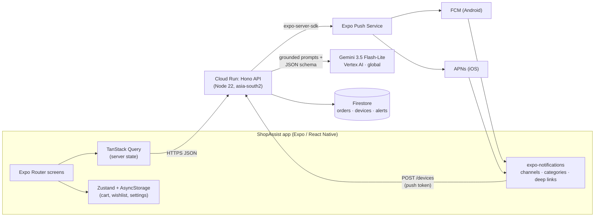

# ShopAssist

ShopAssist is a cross-platform (Android + iOS) shopping app with an AI product assistant that refuses to make things
up. It's built with Expo SDK 58 and React Native 0.88. It has a full catalog with search, a cart and checkout, native gestures,
and push notifications with action buttons that open the right screen even from a killed app. A small Node API on
Google Cloud Run handles orders, push and Gemini. Every AI answer is grounded in the product's own data and reviews, with citations,
and the app holds no API keys. It also takes Indian retail rules seriously: sponsored items are always labelled, and the full
price is shown up front.

| Home | Product + buyer insights | Ask AI | Cart | Push with actions | Order tracking |
| --- | --- | --- | --- | --- | --- |
|  |  |  |  |  |  |

## Features

**Shopping**
- Two-column catalog with skeletons, pull-to-refresh and infinite scroll; categories; wishlist
- Search with a visible button, debounced input, filters (category, price, rating), sort and saved filters
- Cart with quantity steppers and a full price breakdown before checkout (free delivery from ₹499, else ₹49)
- Checkout with address validation and mock payment; orders with a status timeline

**AI** (Gemini on Google Cloud, server-side only)
- **Grounded answers.** Ask about a product. The model sees only that product's data and reviews, cites the reviews it
  used, and replies "That isn't in the product details or reviews." when it can't answer.
- **Buyer insights with citations.** 2–4 pros and 1–3 cons, each linked to the reviews it came from. Points without
  evidence are dropped.
- **Search in plain words.** "gift for dad who cooks under ₹2000" becomes structured filters shown as removable
  chips, with a keyword search as the fallback.

**Gestures**
- Long-press a product → haptic + quick-action sheet (Add to cart, Wishlist, Share)
- Swipe to delete in the cart with an undo snackbar
- Pinch to zoom, double-tap and swipe-to-dismiss in the full-screen image viewer

**Notifications**
- Local cart reminder (2 h; 10 s in demo mode), asked for in context rather than on launch
- Push "Order shipped" with **Track order** / **Rate product**, and price-drop push with **Add to cart** / **View**
- Deep links (`shopassist://order/<id>`, `shopassist://product/<id>`), and the action is handled from a cold start too
- Push diagnostics screen with a real test push (the demo safety net)

**Reliability**
- Error boundaries ("Something went wrong · Try again") instead of red crash screens
- Every request has a timeout, GETs retry, and each data screen has loading, empty, error and offline states
- Queries refetch on reconnect and when the app returns to the foreground
- OTA updates through EAS Update (preview channel); light and dark themes; accessibility labels and 44 pt touch targets

## Architecture



When `EXPO_PUBLIC_API_URL` is unset, the app uses an in-app mock with the same contract (`src/lib/api.ts`), so every screen
works offline. The mock has deterministic stand-ins for the AI.

## Key decisions

| Decision | Why |
| --- | --- |
| **Expo + Expo Router** | One TypeScript codebase for Android and iOS. File-based routes give deep links for free, and EAS handles builds, signing and OTA updates without Android Studio or Xcode. |
| **TanStack Query + Zustand** | Server state (catalog, orders) needs caching, retries and refetching, so it uses TanStack Query. Local state (cart, wishlist, settings) is small and must persist, so it uses Zustand + AsyncStorage. Keeping them apart avoids a single global store. |
| **Server-side AI, no keys in the app** | The app only calls our API. Gemini runs on Vertex AI under a service account, so there's no key to extract from the APK, and prompts, limits and costs are controlled in one place. |
| **Grounding + post-checks** | The prompt contains only the product's JSON and reviews (temperature 0.2, JSON schema output). The server then checks the output. Citations must be real review ids of that product, uncited numbers not found in the data downgrade the answer to the refusal, and insights without evidence are dropped. If the model fails, the server falls back safely instead of returning a 500. |
| **Totals recomputed server-side** | `POST /orders` ignores client prices and recomputes the subtotal, delivery and total from the catalog. It returns 409 if stock is short. |
| **Labelled sponsored items, no drip pricing** | India's CCPA *Guidelines for Prevention and Regulation of Dark Patterns* (2023) cover disguised ads and drip pricing. Sponsored items are always labelled and capped at one per 10 results, and delivery fees appear in the cart before checkout. |
| **Least-privilege service account** | Cloud Run runs as a dedicated service account with only `aiplatform.user`, `datastore.user` and access to the one `ADMIN_KEY` secret. Admin triggers need that key, compared in constant time. |
| **Permissions in context** | Notification permission is requested after the first add-to-cart or when turning on an alert, with an explainer first. It's never requested on launch. |

## Run it

**App** (Node 22+):

```bash
npm install
npm run start:go      # Expo Go: mock API, local notifications
npm run start:dev     # development build: real push, action buttons
```

Set `EXPO_PUBLIC_API_URL` in `.env` to use the Cloud API. Leave it unset to use the mock. Checks: `npx tsc --noEmit`,
`npx expo lint`, `npx expo-doctor`.

**Backend locally** (`backend/`, a separate Node project):

```bash
cd backend
npm install
cp .env.example .env  # STORE=memory needs no Google Cloud access
npm run dev           # http://localhost:8080
npm test && npm run typecheck
```

**Deploy:** see [backend/DEPLOY.md](backend/DEPLOY.md) (Cloud Run, Firestore, Vertex AI, secrets, service account).
**Demo:** see [docs/DEMO.md](docs/DEMO.md). **Builds:** EAS profiles `development`, `preview` (APK + OTA channel) and
`production` in `eas.json`. Regenerate the icons with `npm run icons`.

## Built in 4 days

| Day | Work |
| --- | --- |
| **Sat** | Learning and setup: Expo SDK 58, Router, EAS; project skeleton, theme, data seed, mock API |
| **Sun** | Core app: catalog, search, product, cart, checkout, orders. Then gestures, local notifications with actions, and the Cloud Run backend |
| **Mon** | AI: grounded Ask, buyer insights with citations, plain-words search with post-checks. Real push through Expo + FCM |
| **Tue** | Polish and release: error boundaries, offline handling, icon and splash, accessibility, OTA updates, docs, preview APK |

Product data: [DummyJSON](https://dummyjson.com) demo data, adapted to INR. Not a real store.
